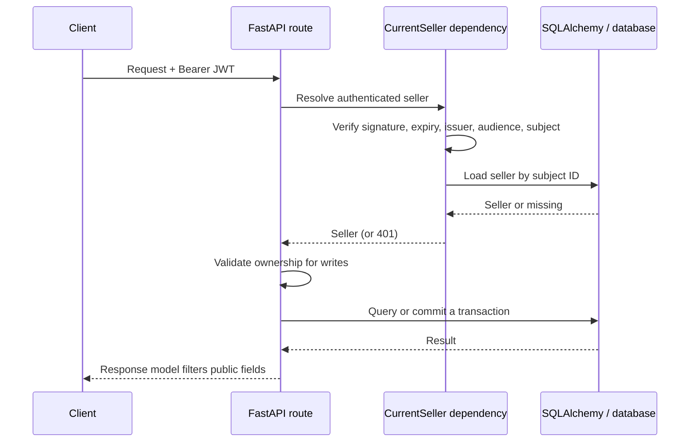

# Products API · FastAPI reference project

A small seller-and-product API for learning and revision: register, sign in, then
create, browse, update, and delete products. It combines a small domain with
validated contracts, explicit transactions, owner authorization, migrations,
and failure-case tests.

The application stays synchronous because its SQLAlchemy sessions and password
hashing are synchronous. FastAPI runs synchronous endpoints in a worker thread.
There is no extra service/repository framework to learn before reading a route.

Read the [FastAPI Field Guide PDF](docs/FastAPI-Field-Guide.pdf) for a concept-first
tutorial with examples from this project and 48 interview questions with model
answers. [PDF source and rebuild instructions](docs/README.md) are included.

## What you will learn

- Routers, typed path/query/body parameters, dependency injection, and OpenAPI.
- Pydantic validation and response models that prevent sensitive fields leaking.
- SQLAlchemy relationships, sessions, transactions, and database constraints.
- Password hashing, JWT claims, bearer authentication, and owner authorization.
- Alembic migrations, isolated HTTP tests, linting, and continuous integration.

## Run locally

Use Python 3.11 or newer. Local verification uses Python 3.15; the GitHub workflow
is configured to check 3.11 and 3.15 after you push the repository.

From the project directory, create an environment if you do not already have one:

```powershell
python -m venv .venv
```

Activate it on Windows PowerShell:

```powershell
.\.venv\Scripts\Activate.ps1
```

On macOS/Linux:

```bash
source .venv/bin/activate
```

Install the development dependencies (includes everything needed to run):

```text
python -m pip install -r requirements/dev.txt
```

For a runtime-only installation, use `requirements/runtime.txt` instead.

Copy `.env.example` to `.env`, then generate a private signing key:

```text
python -c "import secrets; print(secrets.token_hex(32))"
```

Paste the generated value into `JWT_SECRET_KEY` in `.env`. The placeholder is
intentionally rejected at startup. Never commit the generated value. Environment
variables take precedence over `.env`; restart the server after changing settings.

Create the database using the checked-in migration, then start the server:

```text
python -m alembic upgrade head
python -m uvicorn app.main:app --reload
```

Open [Swagger UI](http://127.0.0.1:8000/docs),
[ReDoc](http://127.0.0.1:8000/redoc), or
[the OpenAPI document](http://127.0.0.1:8000/openapi.json).

The application uses `data/app.db`, which is excluded from Git. A fresh clone
starts with an empty database after migrations; register a demo account to begin.
Keep the directory and its `.gitkeep` so SQLite has a place to create the file.

## Try the whole flow

In Swagger UI:

1. Execute `POST /seller` with the example below.
2. Click **Authorize** and enter that username and password. Swagger submits the
   login form to `/login` and attaches the returned bearer token to requests.
3. Execute `POST /product`, then use the returned `id` for GET, PUT, and DELETE.
4. Register a second seller and sign in as them: reads succeed; edits to the first
   seller's product return `403`.

Registration body (use a disposable example password only):

```json
{
  "username": "alice",
  "email": "alice@example.com",
  "password": "LearnFastAPI!2026"
}
```

Product body:

```json
{
  "name": "Notebook",
  "desc": "An A5 notebook",
  "price": 1299
}
```

Prices are non-negative integer **minor currency units**: `1299` represents
`12.99`. The application assumes one chosen currency and does not perform currency
conversion. The `desc` field holds the product description.

The equivalent PowerShell sequence is:

```powershell
$api = 'http://127.0.0.1:8000'
$registration = @{
    username = 'alice'
    email = 'alice@example.com'
    password = 'LearnFastAPI!2026'
} | ConvertTo-Json
Invoke-RestMethod "$api/seller" -Method Post -ContentType 'application/json' -Body $registration

$token = Invoke-RestMethod "$api/login" -Method Post -Body @{
    username = 'alice'
    password = 'LearnFastAPI!2026'
}
$headers = @{ Authorization = "Bearer $($token.access_token)" }
$body = @{ name = 'Notebook'; desc = 'An A5 notebook'; price = 1299 } | ConvertTo-Json
$product = Invoke-RestMethod "$api/product" -Method Post -Headers $headers -ContentType 'application/json' -Body $body
Invoke-RestMethod "$api/product/$($product.id)" -Headers $headers
```

If you already registered `alice` in Swagger, use a different username/email or
skip the registration request. Duplicate identities return `409`.

## API contracts

| Method | Path | Access | Success |
| --- | --- | --- | --- |
| GET | `/health` | Public; checks database connectivity | 200 |
| POST | `/seller` | Public registration | 201; public seller fields |
| POST | `/login` | Form fields `username`, `password` | 200; access token |
| GET | `/seller/me` | Signed-in seller | 200; own profile |
| POST | `/product` | Signed in; ownership assigned from token | 201; product |
| GET | `/product?offset=0&limit=20` | Signed in; browse all sellers' products | 200; list |
| GET | `/product/{product_id}` | Signed in | 200; product |
| PUT | `/product/{product_id}` | Product owner; complete body required | 200; updated product |
| DELETE | `/product/{product_id}` | Product owner | 204; empty body |

Errors use FastAPI's `detail` field: `401` for invalid/missing authentication,
`403` for a non-owner write, `404` for a missing product, `409` for duplicate
registration, and `422` for invalid input. Validation errors omit raw input values
to avoid echoing submitted secrets. Database failures return a generic response;
the server logs the error with bound SQL parameters hidden.

Usernames accept 3–50 ASCII letters, numbers, or underscores and are normalized to
lowercase. This application also deliberately treats emails as case-insensitive.
Passwords accept 12–128 characters and retain spaces. Product names/descriptions
are trimmed, length-bounded, and non-empty. JSON prices must be integers, not
booleans, strings, or floating-point numbers. Unknown body fields are rejected.

## Project structure

```text
app/                       # All importable application code
    main.py                # App factory, middleware, errors, router registration
    database.py            # Engine, session factory, request-session cleanup
    models.py              # Seller/product database tables and relationships
    schemas.py             # Validated request and public response contracts
    api/
        dependencies.py    # Session and authenticated-seller dependencies
        routers/
            auth.py        # Login and token issuance
            products.py    # Authenticated product CRUD and ownership checks
            sellers.py     # Registration and the signed-in profile
    core/
        config.py          # Typed environment settings
        security.py        # Password hashing and JWT signing/verification
migrations/                # Versioned database schema and Alembic environment
tests/                     # Isolated HTTP, authentication, and database tests
requirements/              # Runtime, development, and optional PDF dependencies
docs/                      # Concept guide, PDF, and documentation source
tools/                     # PDF builder; not part of the running application
data/                      # Local database (ignored), plus tracked .gitkeep
.github/workflows/         # Automated lint, format, and test checks
.vscode/                   # F5 debugger configuration
```

`app/` is one Python package with absolute imports. API-specific dependencies sit
beside routers, while security/configuration remain independent of HTTP handlers.
The two related entities fit in one models module and one schemas module. This
keeps responsibilities clear without adding forwarding service/repository layers.
Each package's `__init__.py` marks its import boundary.

Runtime packages live in `requirements/runtime.txt`; development tools and optional
PDF tooling have their own files. `.venv`, `.env`, `data/app.db`, and generated
`.cache/` contents are local working state and are excluded from publishing.

## Read the code in this order

| File | Purpose |
| --- | --- |
| [app/main.py](app/main.py) | App factory, router registration, host checks, safe errors, health endpoint |
| [app/schemas.py](app/schemas.py) | Request validation and explicit response fields |
| [app/models.py](app/models.py) | Typed tables, foreign keys, uniqueness, price constraint |
| [app/database.py](app/database.py) | Engine, SQLite settings, request session cleanup |
| [app/core/config.py](app/core/config.py) | Validated environment settings, cached per process |
| [app/core/security.py](app/core/security.py) | Argon2 password handling and JWT claims |
| [app/api/dependencies.py](app/api/dependencies.py) | Session injection and token-to-seller lookup |
| [app/api/routers/sellers.py](app/api/routers/sellers.py) | Registration, duplicate handling, own profile |
| [app/api/routers/auth.py](app/api/routers/auth.py) | Login form, password verification, token response |
| [app/api/routers/products.py](app/api/routers/products.py) | CRUD, pagination, owner checks |
| [migrations/](migrations/) | Versioned schema rather than import-time table creation |
| [tests/](tests/) | Executable examples of successful flows and failure cases |

Request flow:



`DbSession` is an `Annotated` dependency alias; FastAPI reuses the dependency result
within a request. `CurrentSeller` builds on it. A session is never shared across
requests. Writes explicitly commit; cleanup closes the session and rolls back any
remaining uncommitted transaction. Parameterized SQLAlchemy expressions keep user
values separate from SQL text.

## Debug in VS Code

Select **Debug FastAPI** in Run and Debug and press **F5**. The included
[launch.json](.vscode/launch.json) uses `.venv` on Windows and macOS/Linux. Place a
breakpoint inside a route, then call that endpoint from Swagger UI. This profile
runs one server process without automatic reload; restart debugging after edits.
Stop an existing server on port 8000 before starting another one.

## Tests and code quality

```text
python -m ruff check .
python -m ruff format --check .
python -m pytest --cov --cov-report=term-missing
```

Tests use an isolated in-memory SQLite database and a random test signing key.
Every HTTP request gets its own session. The migration test uses a temporary
database file and checks upgrade, model parity, repeated upgrade, and downgrade.
The local database is never touched by tests. CI enforces at least 90% application
coverage; coverage is useful evidence, not a substitute for meaningful assertions.

When models change, generate and **review** a migration before applying it:

```text
python -m alembic revision --autogenerate -m "describe the schema change"
python -m alembic upgrade head
python -m alembic check
```

Alembic compares the current database with the model metadata. Autogeneration
does not understand every rename or data transformation. Back up real data before
running a migration. `downgrade` can drop data; use it only with a recovery plan.

Dependencies are split into direct `.in` inputs and compiled `.txt` pins. Edit
the inputs and regenerate both files when updating dependencies:

```text
python -m piptools compile --strip-extras --no-emit-index-url --no-emit-trusted-host --output-file=requirements/runtime.txt requirements/runtime.in
python -m piptools compile --strip-extras --no-emit-index-url --no-emit-trusted-host --output-file=requirements/dev.txt requirements/dev.in
```

The optional PDF tooling is maintained separately through `requirements/docs.in`
and its compiled `requirements/docs.txt` file.

Use `--upgrade` when intentionally refreshing existing pins, then rerun checks.
Pins were resolved on Windows/Python 3.15; re-resolve and test for a different
deployment platform if its conditional dependencies differ. Pins are not a claim
that dependencies will remain free of vulnerabilities; review updates regularly.

## Production deployment boundary

This is a production-minded **learning reference**, not a complete identity or
commerce platform. The code demonstrates secure defaults while keeping the
business use case small. Before making an internet-facing deployment:

- Supply a new random secret through the host's secret manager, set explicit
  `ALLOWED_HOSTS`, and keep the same signing key/configuration across workers.
- Use HTTPS and a reverse proxy/API gateway with request-size limits and shared
  rate limits on login and registration. Trust forwarded headers only from that
  proxy. The app does not implement distributed abuse prevention.
- Apply migrations once as a release step. Use a backed-up persistent database.
  SQLite is suitable for local learning and small workloads; use a managed database
  such as PostgreSQL when concurrent writes, failover, or multiple replicas matter.
  Install its synchronous driver and set `DATABASE_URL`, for example
  `postgresql+psycopg://...`. That deployment needs its own integration tests.
- Run Uvicorn without `--reload` behind a process manager/platform that restarts
  failed processes. Monitor errors, latency, health checks, and database capacity.
- Keep passwords, bearer tokens, and authorization headers out of request logs.
  Decide whether public interactive docs should be exposed in your deployment.

The password form lets learners see the complete local
authentication flow. It is not a third-party OAuth authorization service. For
delegated authentication/SSO, use an OIDC provider with Authorization Code + PKCE;
the OAuth security best-current-practice document rejects the resource owner
password credentials grant. See [RFC 9700 §2.4](https://datatracker.ietf.org/doc/html/rfc9700#section-2.4).

Passwords use Argon2id; successful logins upgrade older hashing cost settings when
needed. Tokens contain only an
account ID and standard claims: a JWT is signed, **not encrypted**. Access tokens
expire after 20 minutes by default. There are no refresh tokens, logout denylist,
password reset, email verification, roles, or MFA in this project. Deleting an
account invalidates its tokens because each protected request looks up the seller;
otherwise a stolen token remains usable until expiry. Changing the signing key
invalidates every outstanding token.

Before publishing, review the Git staging area: `.env`, virtual environments, and
database files are excluded by `.gitignore`. Use only disposable demo identities.
Choose a license if you want to grant others explicit reuse rights.

## Primary references

- [FastAPI security tutorial](https://fastapi.tiangolo.com/tutorial/security/oauth2-jwt/)
  — framework security helpers, password hashing, and bearer tokens.
- [FastAPI application packages](https://fastapi.tiangolo.com/tutorial/bigger-applications/)
  — Python packages and reusable routers.
- [Pydantic settings](https://docs.pydantic.dev/latest/concepts/pydantic_settings/)
  — environment and dotenv configuration.
- [SQLAlchemy SQLite notes](https://docs.sqlalchemy.org/en/20/dialects/sqlite.html)
  — foreign keys and explicit transaction handling.
- [PyJWT usage](https://pyjwt.readthedocs.io/en/stable/usage.html)
  — signature verification and claim validation.
- [pwdlib guide](https://frankie567.github.io/pwdlib/guide/)
  — verification and gradual password-hash upgrades.
- [Alembic tutorial](https://alembic.sqlalchemy.org/en/latest/tutorial.html)
  — schema revision management.
- [Starlette TestClient](https://www.starlette.io/testclient/)
  — in-process HTTP testing and its client dependency.
